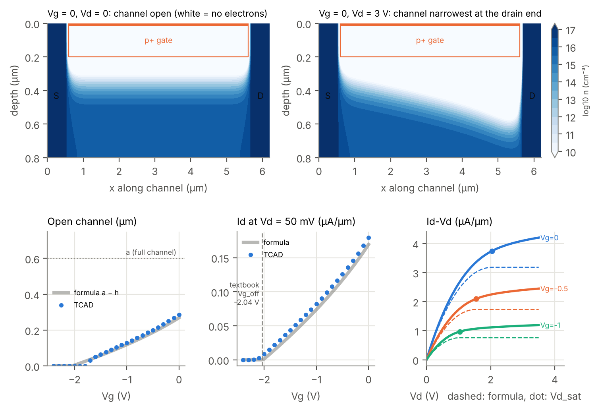

# JFET TCAD (DEVSIM)

오픈소스 TCAD [DEVSIM](https://devsim.org)으로 n채널 JFET을 2-D 드리프트-확산 시뮬레이션하고,
Streetman *Solid State Electronic Devices* 6.1절의 교재 공식과 비교했습니다.

> 코드는 AI 도구(Claude)의 도움을 받아 작성했고, `my_jfet.py`는 제가 직접 작성했습니다.
> 모든 결과는 교재 공식과 비교해 확인했고, 맞지 않는 부분과 그 이유를 아래에 적었습니다.



## 파일

| 파일 | 내용 |
|---|---|
| `my_jfet.py` | **직접 작성.** Vg를 내리며 드레인 전류와 열린 채널 두께 측정 |
| `lessonJ1_jfet.py` | 전체 실험: 공핍층 지도, Id-Vg, Id-Vd, 교재 공식 비교, 그림 |
| `jfet.py` | JFET 구조(격자·도핑·전극)와 풀이 순서, 교재 공식 함수 |
| `common.py` | DEVSIM 설정, 공용 함수, 그림 스타일 |

## 소자와 모델

- n 채널 반두께 a = 0.6 µm, N_D = 1e16 cm⁻³, 게이트 p+ 1e19 cm⁻³, 게이트 길이 5 µm
- 위아래 대칭 소자의 위쪽 절반만 계산 (바닥 = 대칭면)
- 드리프트-확산, 볼츠만 통계, SRH 재결합, **이동도 고정 400 cm²/Vs**

## 결과 (Vd = 50 mV, `my_jfet.py`)

| Vg (V) | Id (µA/µm) | 열린 채널 TCAD (µm) | 공식 a − h (µm) |
|---|---|---|---|
| −0.5 | 0.126 | 0.200 | 0.187 |
| −1.0 | 0.082 | 0.130 | 0.118 |
| −1.5 | 0.044 | 0.065 | 0.058 |
| −2.0 | 0.008 | 0.000 | 0.000 |

| 항목 | 교재 공식 | TCAD |
|---|---|---|
| 꺼지는 게이트 전압 Vg_off = Vbi − Vp | −2.04 V | 약 −2.2 V |
| 포화 시작 Vd_sat (Vg = 0) | 2.04 V | 비슷한 위치에서 꺾임 |
| 포화 전류 (Vg = 0) | 3.18 µA/µm | 3.74 µA/µm |

## 정리한 것

- **핀치오프 전압** Vp = qN_D·a²/(2ε): 공핍 폭 공식에 W = a를 넣은 것 = 접합 **총** 전압이 얼마면 채널이 막히나.
  접합 총 전압 = Vbi − Vg + V(x) 이므로 Vg_off = Vbi − Vp, Vd_sat = Vp − Vbi + Vg.
- 채널은 저항이라 전압이 소스 0 → 드레인 Vd로 오름 → 게이트–채널 역바이어스가 드레인에서 최대 → **드레인 쪽이 먼저 막힘** (그림 오른쪽 위 쐐기 모양).
- 핀치오프 이후 전류는 0이 아니라 **일정(포화)**: 핀치오프 점 전압이 Vd_sat에 고정되고, 추가 전압은 막힌 구간에만 걸림.
- 그림의 실선은 TCAD, 점선은 교재 공식 — **둘 다 계산값이며 실측이 아님.**

## 공식과 다른 이유 / 현실과 다른 점

1. **채널이 조금 더 열려 있고 늦게 꺼짐:** 교재는 공핍층 경계가 칼같이 끊긴다고 가정(공핍 근사). 실제는 수십 nm에 걸쳐 흐릿함.
2. **포화 후에도 전류가 12–23% 증가:** 드레인 근처에서 점진 채널 근사가 깨지고, 막힌 지점이 소스 쪽으로 이동 (채널 길이 변조).
3. **이동도 고정:** 실제 1e16 실리콘 전자 이동도는 약 1,200 cm²/Vs → 실제 전류는 약 3배 큼.
   반면 Vg_off는 정전기(푸아송) 문제라 이동도와 무관 → 어떤 숫자가 어떤 가정에 기대는지 구분해야 함.

## 실행

```
pip install devsim devsim-openblas numpy matplotlib
cd mosfet-tcad
python my_jfet.py                    # 몇 분
python lessonJ1_jfet.py --quick      # 빠른 모드 (그림 생성)
python lessonJ1_jfet.py --plot       # 저장된 결과로 그림만 다시
```

## 다음

- 도핑 의존 이동도(Caughey–Thomas) 모델을 직접 넣어서 "전류 약 3배, Vg_off 그대로" 예측 확인
- MOSFET 포화·핀치오프와 비교
